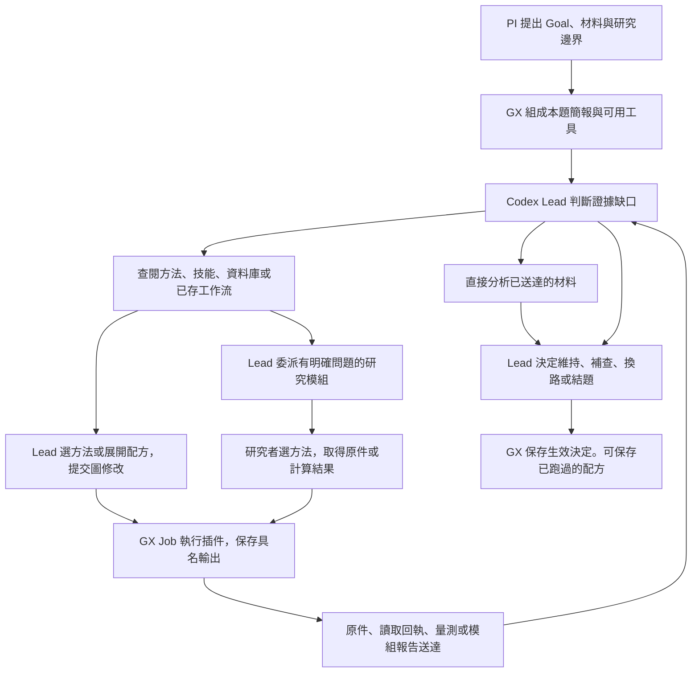

# GX-H 科研能力、插件架構與 Lead 選法審閱

**版本基準**　`science/multi-workflow@3f33fd2`，2026-11-27。部署回執對應 `science-capabilities-release@4eff535`。七個主要 Run 在開發期間分批啟動，各自保留當時的方法版本與首次結果。本文供研究負責人判斷能力邊界，也供開發者實際登記新插件。[部署回執][deployment] · [七個 Run 的索引][series]

**結論**　GX 已經能讓真實 Codex Lead 查方法卡、委派研究、執行插件、讀取原件、依證據改變行動，並把成功執行的子圖留給下一題。最值得先修的是**發現範圍和搜尋方式**。方法可以已安裝、也真的能回答問題，Lead 卻可能因為開題時沒有預選它、選錯目錄類別，或用了卡上沒有收進摘要的詞而錯過它。已有一個後繼研究即使找到了正確配方，仍重跑了同一份方法校準。[目錄實作][catalog] · [真實配方重用][recipe-real]

### 閱讀方式

快速跳轉　[系統分工](#gx-section-2) · [方法卡](#gx-section-3) · [Lead 呼叫](#gx-section-4) · [插件登記教學](#gx-section-5) · [真實例題](#gx-section-6) · [問題清單](#gx-section-7) · [改進設計](#gx-section-8) · [驗收矩陣](#gx-section-9) · [復核入口](#gx-section-10)

- **研究者**可先看第 2、4、6 節，了解 Lead 看見什麼、如何選法，以及哪些結果由真實模型和 Job 產生。
- **插件作者**可直接看第 3、5 節，對照方法卡、註冊 API、安裝指令和 Goal 設定。
- **決定下一版範圍的人**可看第 7 至 9 節，對照可重現的漏檢、實際重工及建議驗收。第 10 節提供復核入口。

<a id="gx-section-1"></a>

## 1. 這次能從紀錄回答什麼

| 證據 | 本文如何使用 |
|---|---|
| 官方 Codex 實跑 | 七個主要 Run 都有結題事件。結題前啟動 92 個官方模型回合，另有 1 個結題後 PI 追問回合。共 85 個 GX Job，78 成功、7 失敗。這是具體研究集合的統計，不能外推成平台可靠率。 |
| 受控整合實驗 | 腳本可代替模型呼叫原生工具回調，派出的 CPU Job、連到的 MCP、抓回的檔案仍可是真的。這類實驗能證明接口與執行環境能工作，無法用來判定模型會自發選中該能力。 |
| 獨立復算與唯讀重放 | 可在原始 SQLite、原件與部署會話上核對呼叫順序、引文、結果及結題決定。本次整理重新核了七題的查目錄順序、蔗糖題的搜尋漏檢，以及兩道酵母題的已發布復核 JSON。 |
| 架構建議 | 第 8、9 節是下一版可實施的變更及驗收條件。本文另在臨時部署副本驗證插件安裝指令。整理本文新增模型回合 0。 |

七題中，逐 Run 限定 `scope='run'` 的 Lead 執行緒，都能在首次 `gx_decide_revision` 請求前查到至少一次 `gx_query_catalog`。這個統計只證明呼叫順序。有的題直接查已知方法名，有的題面明說「查看目錄」或「沿用前題工具」。不能據此宣稱七題都完成了不靠提示的自主發現。[研究驗收][accept] · [父題題面][parent-question] · [後繼題面][child-question]

<a id="gx-section-2"></a>

## 2. 從研究問題到科學決定

`Research scope` 在這條路徑中體現在 Run 的問題、材料、方法選項、委派子問題及應交付的證據。Lead 可以先解讀已有結果、開一條分支、向多個模組委派不同調查，或在證據足夠時停止。問題拆解的粒度、分支數和工具順序由 Lead 按本題需要選擇。[Lead 決策指令][lead] · [真實並行研究][parallel]



| 元件 | 擁有哪個決定 | 可追到的產物 |
|---|---|---|
| PI / Goal | 指定問題、資源與材料邊界，可預選 provider、方法和備選版本 | 原始題面、Goal 設定、工作區與 Run ID |
| Codex Lead | 決定缺什麼證據，採用、委派或組合哪個方法，讀後是否改路 | 生效決策、引用、分支、停止理由 |
| 科研模組 | 在所領子問題內選檢索詞、查材料、選後續作業、提交發現及缺口 | 委派範圍、具名輸出、作者報告、送達回執 |
| 插件 / MCP / 資料 provider | 實作某項方法、讀取外部服務、輸出原始資料或具名計算 | 方法版本、外部資料版本、原始檔、結構化輸出 |
| GX | 綁定方法與輸入、派 Job、管理並發及恢復、把讀數送回有權決定的任務 | SQLite 事件、Job 身分、Artifact、讀取與結題紀錄 |

本系列的模型執行走已部署的官方 Codex OAuth。一般研究的用量依現有回執粗略記錄。本文所追的文獻與酵母能力經 GX 的 Python 插件入口和 Job 執行。程式庫另有選配的 DSH/Cordis 評估器，供特定 workflow 呼叫。單一 UniProt `stdio` MCP、Codex 原生動態工具與 Cordis 評估器，是三個不同層次的介面。[研究啟動方式][running] · [Codex 工具組裝][native-tools] · [選配評估器][cordis]

<a id="gx-section-3"></a>

## 3. 科研能力怎樣組織

### 3.1 四個業務層，六種可查的目錄項

| 科研層 | 目前機制 | 已證明的範圍 |
|---|---|---|
| Research / 理解 | `research` 查文獻與來源操作，`module` 查可委派的研究角色，`skill` 查已發布技能或舊說明 | Europe PMC、Crossref 找候選，開放文章按 PMCID 取 JATS 原件。研究者可用 `gx_read_source`、`gx_extract_evidence`、`gx_review_evidence` 讀、摘、核。arXiv 的版本化 PDF 與研究者交接另有受控回執。 |
| 工具 / 模型 | `method` 提供可執行方法。原生 `goal_tool` 可在適用方法已授予時提供專用操作 | CPU 分析、結構質控、資料查詢、受限的方法派生已實跑。Top7 的獨立 GPU 對照另行執行。不能將這筆 GPU 對照計入 Lead 自行派發的 GX Job。 |
| Workflow | 插件可貢獻已部署工作流。`recipe` 可列出本工作區從真實成功節點保存的配方，也可有純參考卡 | `gx_save_recipe` 保存已執行子圖。`gx_instantiate_recipe` 產生可提交的圖操作。後繼研究已成功展開後派 Job、讀數及結題。 |
| 資料 / MCP | `database` 查已映射的資料能力。外部 MCP 可由一個具名 GX 方法包裝 | S288C 本地反應索引、官方 UniProt 記錄、MacromNex UniProt MCP 各有方法卡。Lead 看見的是可選的 GX 方法及其科學用途，後端再呼叫具體的 MCP tool。 |

上述六種查詢類型與插件 manifest 的擴展類型分屬兩個介面。一個文獻插件能同時提供數個方法和一個研究模組。同一方法也能出現在 `method` 和 `research`。在這個版本，理解技能及舊案經驗的成熟度有差異。`source-evidence-review@1` 可向具備相應讀取工具的研究者說明如何讀、摘、核。`gx-understand@legacy`、`paper-to-skill@legacy`、`paper-to-agent@legacy` 則以 `reference_only` 提供原說明位置、用途及相關方法。明確指定前序 Run 時，後繼簡報可帶入其結論和材料。從完全無關的新題自動推薦歷史失敗與適用條件，尚缺正常入口驗收。[目錄資源實作][resources] · [舊能力登記][legacy] · [前序研究繼承][predecessor]

舊部署盤點曾找到 117 個 MCP 元件、958 個工具定義、192 條 workflow 定位和 554 個技能檔案。數字有交集，代表可追查的遷移來源。舊 RFD4、AP.Novo 等路線在本系列只有歷史定位及原驗收邊界，新增該類 GX 生成 Job 為 0。微信公眾號及小紅書可登記公開連結或接收獲准匯出的內容。當次線上預檢實得正文 0 篇。[遷移清單][migration] · [社群來源回執][social]

### 3.2 Lead 實際看得到的介紹

1. **首輪短卡。** 在兩道真實酵母題中，開場各有 5 張方法短卡、3 個可委派模組，另列讀原件、摘證及複核入口。短卡含方法版本、類別、用途、成本級與輸出，方便 Lead 判斷「能拿到候選，還是能拿到原文」。大目錄超過項數或大小門檻時先顯示分類與數量，再按需查詢。這五張卡來自題目設定。[簡報投影][catalog-summary] · [酵母設定][yeast-goal]
2. **按版本讀完整方法卡。** 已註冊 Job 方法要求方法家族、目標、機理、估計方式及訓練資料來源。方法描述還提供輸入角色、具名輸出和局限。對有宣告的量測，可取得指標定義和單位。對無訓練模型的工具，資料來源欄可直接說明使用公開資料或確定性算法。原生動態工具另有操作說明與參數 schema。[卡片欄位][card-fields] · [公開卡投影][public-card] · [原生工具契約][tool-schema]
3. **辨別可用狀態。** `available` 表示當前 Goal 有該方法或資源的使用條件。`selectable` 表示屬本題備選，可由 Lead 啟用。`catalog_only` 是看得到的公共方法卡。`reference_only` 是定位資料。配方的 `requires_method` 表示其必要方法版本或摘要尚未齊備。不同類型的摘要與精確查詢返回欄位有差異。執行是否成功，應回看相符版本的實際 Job。[方法狀態][catalog-status] · [資源與配方狀態][resources] · [同題啟停][views]

**例子。** `scholarly-search@1` 接受研究者自選檢索詞，回傳候選文章、可取全文的 PMCID 和檢索快照。`scholarly-fetch@1` 要求從已有候選選 PMCID，回傳原始 `article.xml` 和取得紀錄。`yeast-reaction-index@2` 從物種和底物產生候選蛋白。`yeast-uniprot-record@2` 需要其中一個編號才可取得官方記錄。`yeast-enzyme-mcp@2` 可以對同一編號透過舊服務交叉讀取。最後兩者共用 UniProtKB，不能替同一功能判斷增加第二份獨立實驗證據。[搜尋卡][search-card] · [全文卡][fetch-card] · [索引卡][yeast-index] · [原件卡][uniprot-card] · [MCP 卡][mcp-card]

<a id="gx-section-4"></a>

## 4. Lead 如何調用、委派和讀回結果

| 決策時刻 | 呼叫或動作 | 成功到哪一步才算數 |
|---|---|---|
| 想知道有哪些能力 | `gx_query_catalog` 可指定 `kind`，再按 `reference`、`category`、`query` 或分頁查詢 | 目錄回覆只證明該卡對當前任務可見。 |
| 選定一項可啟用方法 | 對本題列明的選項，Lead 可透過 `gx_select_capability` 提交方法版本、`enable` 和目前 revision | 取得新的能力視圖。已有 Job 保留原身分，新 Job 會依目前視圖准入。 |
| 親自安排調查 | `gx_decide_revision` 提交含 `add_node` 的決策，指定 capability、輸入、有效參數及科學問題 | GX 採納圖操作後，具名 Job 開始。完成後才有可引用的測量或原件。 |
| 委派調查 | `gx_open_module` 指出子問題、材料及允許的方法。模組可自行查卡和派 Job | 模組提交含來源的報告，送達後再看 Lead 是否引用並採取行動。GX 兜底的部分報告另記。 |
| 閱讀來源、核對結果 | `gx_read_artifact` 取可見產物，`gx_read_source` 定位原始段落，摘取與複核有對應回執 | 能追到來源和位置，並區分作者摘要、全文、原始數值和模型解釋。 |
| 調用一個工作流 | `gx_instantiate_recipe` 傳入確切配方、摘要、分支與本題輸入，將返回操作交給正式決策 | 配方展開、決策採納、Job 完成、Lead 讀回是四個不同事件。 |

例如，Lead 可以把以下兩組參數交給 `gx_query_catalog`。第一個查資料方法能否做所需的比對。第二個讀選定版本的完整卡。對已在首屏且用途明確的方法，實際執行可直接引用其版本。[查詢契約][tool-schema] · [原生 Lead 選法與派工][lead]

```json
{"kind":"database","query":"BLASTp","limit":5}
```

```json
{"kind":"method","reference":"yeast-reaction-index@2"}
```

`quick`、`medium`、`deep` 會影響這條路徑。未填研究強度時預設 `quick`，通常沒有通用方法目錄。特定策略下，工作區已有 recipe 時會開放配方查詢。`medium`、`deep` 的 Lead 有一般目錄入口，研究模組仍按設定和任務範圍獲得工具。真正的科研精簡應保留 Lead 自行解讀原文和既有數據的自由。需要新原件、新量測或可重跑之方法時，則應留下對應 Job 和產物。[研究強度][effort] · [Lead 工具組裝][native-tools]

<a id="gx-section-5"></a>

## 5. 如何寫、安裝及登記一個插件

### 5.1 四個容易混淆的身分

以酵母 MCP 為例，部署包是 `org.gx.yeast-enzyme-evidence@1.0.1`。包內提供給 GX Job 的方法是 `yeast-enzyme-mcp@2`。它在外部 `uniprot-server` 上呼叫 `get_protein_info`。一次執行又有單獨的 `gxj_…` Job ID。包版本、方法版本、MCP 工具名、Job ID 都有用途。排錯時若只記一個「MCP 失敗」，就無法判斷是插件載入、服務啟動、資料缺失，還是某筆呼叫失敗。[插件 manifest][yeast-pkg] · [MCP 實作][mcp-launch]

### 5.2 插件作者需要提供什麼

以倉庫中可運行的文獻插件為例，`gx_plugin.json` 宣告 `id`、`version`、`api_version`、`kind`、`entrypoint`、`gx_compat`、`dependencies` 及 `extensions`。`plugin.py` 提供 `register(ctx)`。各方法有自己的 manifest，並指向入口程式及所需資料。插件可包含包內模組，特定方法也可宣告外部環境、資料庫快照或服務掛載。以下取自現有插件的註冊方式，省略各方法本身的實作。[插件 schema][pkg-schema] · [文獻插件 manifest][sch-pkg] · [完整註冊函式][sch-reg]

```python
def register(ctx):
    for method, name in ((SEARCH, "search"), (FETCH, "fetch"), (SOCIAL, "social")):
        ctx.capabilities.add_manifest(f"methods/{name}.json")
        ctx.goal_methods.register(method, validate=validate, bind=bind)
```

| 想讓插件提供什麼 | 作者介面及效果 |
|---|---|
| 可派 Job 的方法 | `ctx.capabilities.add_manifest(...)` 登記方法宣告。可用標準綁定，或由 `ctx.goal_methods.register(...)` 提供 `describe`、`validate`、`bind`、`project`、`dependencies` 等專屬行為。例如全文取得只接受相符的搜尋候選及 PMCID。 |
| Lead 在特定方法下可直接呼叫的操作 | `ctx.goal_tools.register(...)` 綁定工具名、方法、描述、參數 schema 和 handler。例子有根據已完成開發 Job 安裝已校準方法。一般 `ctx.tools.register(...)` 屬另一種擴展，能在包中登記普通工具。出現在包的 verify 輸出，不等於它會出現在每個 Goal 的 Lead 工具列表。 |
| 可委派的科研模組 | `ctx.research_modules.register(...)` 宣告子問題用途、工作重點、輸出、允許的強度、方法和工具，以及模組指示。`scholarly_investigation@1` 允許研究者自選檢索詞、取得文獻、摘取位置並報告證據缺口。 |
| 靜態工作流或既有評估功能 | 用對應 workflow 擴展及 hooks 接入既有執行機制。動態研究中途從成功子圖保存 recipe 另走 `gx_save_recipe`。兩種來源都可供重用，生命週期不同。 |
| 理解技能或舊資料定位 | 這版的 `skill` 是目錄視圖。它投影既有證據閱讀能力、已啟用且符合條件的派生方法，另可讀 `research_asset_cards.json` 的參考卡。通用插件 manifest 的擴展列舉目前沒有一個可把任意 `SKILL.md` 轉為可執行能力的 `skill` 合約。 |

插件作者應把「能回答哪種問題、要求哪類輸入、回傳何種證據、何時不足以下結論」寫入方法卡。正式 Job 的宣告還需符合該方法的輸入輸出、所需環境與資源。實際可直接參考文獻插件和隨發行版交付的五文件確定性工具。將舊 MCP 接成已讀、可追溯的資料方法時，要讓卡片說清服務名稱、實際 operation、讀的是哪個資料源以及結果版本。[作者 API][author-api] · [作者指南][plugin-guide] · [技能投影][skills] · [派生工具原包][portable]

### 5.3 登記實際落在哪裡

1. **目錄 → 安裝包。** `plugin digest` 計算整包內容摘要。`plugin install` 檢查傳入摘要，把包存為 `gx-h/plugins/installed/<id>/<version>/`，在 `gx-h/config/workflow_packages.json` 的 `plugins` 中登記 `path` 和 `sha256`。同版本同內容再安裝會沿用現有記錄。同版本不同內容會報衝突。發布修改應使用相應的新版本。[安裝流程][cli]
2. **安裝包 → 已載入貢獻。** `plugin verify` 解析確切包及依賴、呼叫入口 `register(ctx)`，比對宣告和實際註冊的擴展類別，並輸出套件身分及可列出的貢獻。對包內能力，輸出可能是 `method.json` 等檔案名。實際方法 ID 與版本在該 manifest 裡。這一步不會啟動每個外部服務，也不會替所有方法跑一次科學工作。[載入與註冊][loader] · [命令輸出實作][cli]
3. **已載入 → 本題有效方法。** `plugins` 選 provider，`capabilities` 選精確版本方法，`research_modules` 選研究模組。同一方法有多個提供者時，需要明確供應版本。建題時 GX 保存所用提供者、方法身分、內容摘要及目錄。`capability_options` 可另列精確方法和摘要供 Lead 日後選擇，當前 Run 有自己的有效視圖。[Goal 綁定][goal-bind] · [酵母設定原件][yeast-goal] · [同題能力視圖][views]
4. **本題有效 → 科學證據。** Lead 或研究者提交決策、GX 派 Job，把指定輸入與輸出寫入該 Run。下一輪收到讀數後，才可能形成有依據的行動或結論。原生工具另可留下來源與閱讀回執。[研究入口][running] · [正式研究決定][yeast-review]

### 5.4 可照做的 CLI 例子

下面用真實研究產生並封存的五文件包。執行位置為產品根目錄。在你打算登記該版本的部署執行安裝。查看歷史研究只需讀取其證據檔。本例的摘要只適用於該封存版本。[包來源、摘要及安裝示例][portable]

```bash
bundle=acceptance/science_capabilities/portable_method/plugin
gx_python=.venv/bin/python

"$gx_python" -B bin/gx-p0 plugin digest "$bundle"
"$gx_python" -B bin/gx-p0 plugin install "$bundle" \
  --sha256 b4bcef57d78bf4ed151427e647f95394a8e8314c77b1e1c1998fdfe55a92dd2d
"$gx_python" -B bin/gx-p0 plugin list
"$gx_python" -B bin/gx-p0 plugin verify \
  org.gx.record-coverage-8902880ed9d712bf6baa5899@1.0.0
```

本次在臨時部署副本以空白插件清單、既有 Python 依賴和正式 CLI 做過實查。同一包安裝兩次，`list` 中只有一條記錄。`verify` 回傳 `capabilities: ["method.json"]`、`failures: {}`。這個包有 `gx_plugin.json`、`plugin.py`、`method.json`、`method-spec.json`、`coverage.py`。該結果驗證部署及登記。新材料上的實際讀數見第 6.4 節。

若要把它交給新題的 Lead，在完整 Goal 設定中加入以下欄位，同時另備問題和兩份輸入。兩個輸入依次是含 `candidates[].accession` 的隊列表，以及含 `pointers[].entry`、`pointers[].pmid` 的證據表。對這套已安裝方法，具名結果是 `coverage.json`。[可攜方法與輸入定義][portable]

```json
{
  "plugins": ["org.gx.record-coverage-8902880ed9d712bf6baa5899@1.0.0"],
  "capabilities": ["record-coverage-8902880ed9d712bf6baa5899@1"]
}
```

現有管理 CLI 提供 `digest`、`install`、`list`、`verify`。運行中需停用某方法，使用既有 `capabilities --disable` 入口更新該 Goal 的選法。這允許後續工作改路，原先已准入的 Job 及歷史結果仍按原版本解讀。需要再啟用、處理版本並行或恢復原題，可依同題視圖及發布回退說明操作。直接刪除安裝目錄會使依賴該版本的工作失去提供者。[同題啟停語義][views] · [遷移與回退][migration]

<a id="gx-section-6"></a>

## 6. 之前的例題到底怎樣調工具

### 6.1 七個原始 Run 的執行清冊

下表的回合按結題前啟動計，Job 欄為成功／失敗。對照模型當時拿到的確切軟體版本，請查各 Run 的 `admitted_on` 及 `exported_on`。單筆研究的獨立數值復算、腳本對照及結題後追問另行統計。[機讀總表][series] · [獨立對照][controls]

| 研究與 Run ID | 官方回合 | Job 成／敗 | 結題事件 | 工具真正帶回什麼 |
|---|---:|---:|---:|---|
| Top7 `gxr_01m8d9q2erbx9qn5qy` | 2 | 1／0 | 69 | 已沉積 1QYS 的 106 個宣告位置中，92 個有完整骨架。3–94 位 Cα 回轉半徑 12.216 Å。解讀範圍為有座標的區段。 |
| 6BEN `gxr_01m8d9q2ek5mrngbzk` | 3 | 2／0 | 109 | 原件及移除一條連接宣告的對照保有相同的 20 組端點距離，但檔案中的閉環宣告改變。這組對照揭示幾何接近不足以單獨判斷拓撲。 |
| BglB `gxr_01m8d9q2bhtbhacqk7` | 2 | 1／0 | 81 | 已發表資料的留出集合有 41 項，30 項有定量值，14 項有相配評分，後者 Spearman ρ 為 0.259626。新增來源與小分母限制了解讀。 |
| 海藻糖 `gxr_01m8d9q2sexhdhq33k` | 44 | 38／5 | 2617 | 搜文獻、取原文、讀原始記錄、回到方法段核對樣品，保留菌株層級直接酶活證據缺口。 |
| 蔗糖 `gxr_01m8d9xyhw3b1ftg09` | 32 | 32／2 | 2083 | 查文獻和 UniProt，將完整細胞讀數與不同菌株的純化製劑分開。更換底物後再查索引，候選由 1 個變為 3 個。 |
| 文獻指標覆蓋父題 `gxr_01m8d9xyaych3h1z2b` | 6 | 2／0 | 147 | 先開發和校準欄位關聯方法，再計算 2/3，保存工具和工作流。 |
| 文獻指標覆蓋後繼題 `gxr_01m8daq09da52k64ar` | 3 | 2／0 | 255 | 選用同一工具、展開舊配方，在新快照得到 0/1，據此保留補檢缺口。 |

### 6.2 酵母題的完整鏈條

兩題正式啟動資料庫的 `run_input` 都只有兩份小型 JSON。其中一份是 `gx.scholarly-request/1` 的請求格式，一份限定物種 `taxid=559292`。初始資料沒有附論文或預製結論。題面已指定底物和要辨別的科學問題，並預配能力。海藻糖題還要求文獻、資料庫路線並行。Lead 與受派研究者仍須自選檢索詞、文章、資料庫條目與下一項調查。[原始設定][yeast-goal] · [題目][yeast-question] · [檢索請求][request] · [物種範圍][scope]

| 實際環節 | 海藻糖 | 蔗糖 |
|---|---:|---:|
| `scholarly-search` 成功檢索 Job | 24 | 15 |
| `scholarly-fetch` 成功取回／不同全文篇數 | 10／7 | 13／11 |
| 能從 GX 閱讀回執對回原 XML 的定位摘錄 | 110／110 | 93／93 |
| 同宿主、新上下文的 `SUPPORTED` 複核紀錄 | 36 | 29 |
| 模組作者提交／GX 兜底的報告 | 1／3 | 2／1 |

**一次完整選法。** 海藻糖 Lead 讀取候選清單，查 `scholarly-fetch@1` 的完整卡，確認 PMC3953731 可取全文。它想分辨的是「這些酶對海藻糖測過而未檢出活性，還是論文本來就沒測」。它用候選產物 `gxa_01m8d9vnsptt42z86e` 和 PMCID 派出 `gxj_01m8d9y2vpf58ppjgs`，成功取得 `article.xml` 與 `acquisition.json`。論文表 2 在所測條件下對海藻糖有零值，其他底物有正讀數。結題保留了製劑及條件限制。另一次，研究者核對 PMC11540316 的 p26，發現釋糖來自外加檢測酶，不能把細胞樣本讀數直接歸給某個天然酶。Lead 因而又按舊基因名 YBR0106 補檢。[實際 Job][tre-job] · [海藻糖結題][tre-decision] · [逐段復核][yeast-review]

**另一條路線。** 蔗糖 Lead 讀過 PMC11462787 的 p19、p65，區分商品轉化酶製劑與有明確來源的菌株。又讀 P00724 的註釋，決定以另一底物重查候選集合。兩份作者報告進入結題證據。正式狀態將具名 S288C 親本天然純化 Suc2 的直接歸因保留為 `insufficient`。兩題的 `SUPPORTED` 摘錄複核是對局部材料和解釋的判斷，不能替代正式命題狀態。[蔗糖結題][suc-decision] · [逐項證據][yeast-json]

**有沒有繞過插件讀 paper？** 在兩題保存的 65 份 Codex 會話中，前次逐工具核查未發現以 Shell、瀏覽器、直接 HTTP 或本機檔案讀取另行取得論文。研究者有用通用工具呼叫容器批次呼叫 GX，也有拿 GX 檢索快照解碼舊文摘要。後一類只計摘要。驗收腳本事後直接讀存檔 XML，重算雜湊、比對引用。這與研究者當時的獲取途徑可從時間及回執區分。PI 也曾追加「核對底物、製劑和測量」的提示。這項判斷限於保存的會話、Job 及 Artifact。[閱讀回執的核法][verify-yeast] · [PI 介入及後續行動][parallel]

### 6.3 同一個 MCP 四次失敗的診斷

海藻糖 Run 固定使用 `yeast-enzyme-mcp@1`，目標為 MacromNex UniProt 的 `get_protein_info`。前三次分別讀三個 accession，第四次單獨重試第一個。四筆都在 `session.initialize()` 握手時返回 `Connection closed`，退出碼 1，四份 stderr 的內容摘要完全相同。服務尚未收到 accession，所以四筆都沒有帶回蛋白記錄。[正式 Run 中的失敗計數][yeast-json] · [外部服務啟動順序][mcp-launch]

| 時間 UTC | 目標 | GX Job |
|---|---|---|
| 01:28:50 | P35172／NTH2 | `gxj_01m8d9x5zywch1b3x8` |
| 01:28:51 | P32356／NTH1 | `gxj_01m8d9x66txv6bfd2t` |
| 01:28:51 | P48016／ATH1 | `gxj_01m8d9x6efc9jaz9zx` |
| 01:30:41 | P35172／NTH2，再試 | `gxj_01m8da0hv425z6hwsm` |

舊啟動器依 Job 的 `PATH` 找到 `/usr/bin/node`，現場為 12.22.9。原 stderr 只保留尾段，能直接看出握手中斷。對同一部署的啟動依賴做離線對照時，Node 12 無法解析 `undici` 的 `??` 語法，Node 22.17.0 成功載入。插件 `1.0.1` 對應的 `yeast-enzyme-mcp@2` 固定了 Node 路徑。兩個獨立受控 Run 分別成功讀回 P32356 第 202 版和 P00724 第 203 版，完整 MCP 記錄各與官方 REST 原件一致。原 Run 仍保留四次失敗。本組新版對照沒有測到 P35172 和 P48016。原海藻糖研究則透過另一個 REST 方法成功取得三份原件。[修復內容][mcp-launch] · [執行環境][mounts] · [海藻糖新版回執][mcp-tre] · [蔗糖新版回執][mcp-suc]

這個例子顯示 Lead 選工具時需同時知道**科學用途、部署可用性、來源獨立性**。一項方法有授權可以嘗試。同版本連續啟動失敗，適合換路讀資料。REST 和 MCP 即使都成功，來源相同仍只能算一份資料庫證據。

部署機可從產品根目錄下的相對路徑 `../gx-science/capabilities-check/live-trehalose/state/artifacts/gxr_01m8d9q2sexhdhq33k/jobs/<Job-ID>/logs/stderr.txt` 查看這四份原 stderr。研究回合與測試回合的資料分目錄保存。查新版成功時，請用上段所列受控回執中的 Run ID 和 Job ID，避免把另一個測試的成功記回原 Run。

### 6.4 真實派生方法及跨題工作流

覆蓋率父題要求找出有實驗文獻指針的唯一 accession 比例。Lead 查過方法、模組、recipe 等目錄，讀方法來源並選欄位，透過 `derive-record-coverage@1` 的開發 Job 校準。這個 builder 以已驗證的執行模板和研究者選定的欄位、出處產生一個版本化包。`gx_install_record_method` 將已完成的開發輸出安裝並掛入本題方法視圖。模型的自主部分包括選欄位、選材料、決定去哪裡補證據。固定模板支援的能力是記錄關聯與證據覆蓋。任意論文或程式庫自動生成任意科研工具，超出本次實驗。[派生工具設計][development] · [builder 註冊][builder] · [真實父題][recipe-real]

| 物件 | 父題 | 後繼題 |
|---|---|---|
| 方法與配方 | 安裝 `record-coverage-8902880ed9d712bf6baa5899@1`，保存 `accession-pmid-coverage@1` | 查到同一配方，採用同一版本方法，將本題 cohort 與 evidence 綁到配方 |
| 開發／校準 Job | `gxj_01m8da00qebs016yyw` | `gxj_01m8db05gcf0h9t489` |
| 正式測量 Job | `gxj_01m8da74da9jr15fc4` | `gxj_01m8db0633cg9nc1m4` |
| Lead 實收及生效動作 | 2/3，有指針者先讀原文，缺指針者另查。事件 147 結題 | 0/1，保留唯一條目及其文獻缺口。事件 255 結題 |

這條鏈既驗證重用，也暴露重工。配方把校準和測量兩個節點一起保存。測量的資料輸入只有 cohort 與 evidence，但配方另記了它依賴校準節點。後繼展開整張圖，於是同一份校準原件重跑一次。新快照的正式測量有必要，重跑舊校準的新增資訊未在回執中體現。父題與後繼題曾分別有 8 次及 11 次決策提交遭拒，最後才成功。應把生效的動作及首次失敗都納入易用性評估。[配方原件][recipe-json] · [完整血緣回執][recipe-trace] · [決策及重複計算說明][recipe-real]

<a id="gx-section-7"></a>

## 7. 漏洞、風險與證據強度

這裡的漏洞主要是會讓研究者漏用工具、重複計算或錯判證據的工程缺口。以下按對研究結果與時間的影響排列。

| 優先 | 已觀察到的現象或設計事實 | 可能的科研後果 |
|---|---|---|
| 高 | **已裝插件的可見範圍不完整。** 公開方法清單目前從五個內置 manifest 生成，另合併本題已啟用方法及明列備選。安裝目錄中的其他插件未必在新 Goal 的查詢範圍內。預設 quick 還會省略一般目錄。 | 題目設定者若不知道工具名，Lead 可能把「本題沒查到」當成「沒有這種能力」，改走低品質替代路徑或重建已有工作。 |
| 高 | **同一個詞、不同類別會得到矛盾的發現結果。** method 主要在短卡上比對連續字串。research 和 database 會檢索較完整的內容。部分資料角色由 family 名稱或輸出特徵推斷，酵母家族還有專門判斷。 | Lead 必須猜對分類、語言或拼寫。完整卡明明描述了所需算法，在方法搜尋中卻可能為零。新插件也可能被排進令人意外的分類。 |
| 高 | **已有重用成功例，但未驗證無提示下的穩定選法。** 七題都有先查目錄的呼叫。部分題目預配了相關插件或直接要求先查。覆蓋率自建受指定 builder 與已發佈模板約束。 | 失敗模式可能是自己拼一個相似工作流、用參考卡冒充實作，或憑資料庫註釋回答需實驗證據的問題。這是待驗風險，本次沒有發現模型繞開 GX 直接下載論文。 |
| 中高 | **工作流把先後次序與資料依賴一起重放。** 父題與後繼題的校準原件相同，後繼仍派了新的校準 Job。現有保存入口要求選入歷史依賴，展開時再逐步產生節點。 | 長方法開發、校準或昂貴測量一旦被整段保存，每個新資料集都可能多付一次成本。反之，粗暴地跳過校準也會掩蓋方法或環境已改變的情況。 |
| 中 | **`available` 只反映本題使用狀態，近期失敗在別處。** 原海藻糖 Run 的同版本 MCP 有 4 次失敗、0 次成功。其可用授權與失敗 Job 屬不同記錄。GX 已能在決策簡報顯示近期失敗，但方法卡上沒有統一帶出同部署最近一次實際執行結果。 | Lead 比較替代工具時可能重試同一個確定性啟動錯誤。若把技術失敗寫成「未找到條目」或科學陰性，結論會失真。 |
| 中 | **可讀說明、可執行技能與已跑過的 recipe 不同。** 舊理解技能可列舊說明。現有可執行派生技能主要支援記錄覆蓋類。全新工作區可裝五文件方法包，但目前沒有把獨立 recipe JSON 直接收入空目錄的一般 CLI。 | 把舊庫盤點數當成可直接使用的科研能力數，會高估可用範圍。搬到另一部署時，也可能出現「有配方檔，Lead 查不到」的落差。 |
| 中 | **多個工具名稱可能指向同一證據源。** UniProt REST 和 MacromNex MCP 都讀 UniProtKB。同一篇論文也可由不同檢索 Job 多次取得。部分模組因限制或任務失敗只返回 GX 兜底報告。 | 若按工具數、下載次數或報告份數計獨立支持，會放大證據強度。兩道酵母題已有原件去重及作者區分，應保留這些做法。 |

證據入口涵蓋公共方法清單、兩種索引的搜尋邏輯、配方保存與展開、舊能力清單及模組作者。[內置方法][shipped] · [公共卡與授權合併][catalog] · [短卡搜尋][catalog-filter] · [跨類別資源搜尋][resources] · [配方執行][recipe-code] · [酵母原始回執][yeast-json]

### 在同一個蔗糖 Run 上重現搜尋盲點

以當前程式唯讀查詢 `gxr_01m8d9xyhw3b1ftg09` 的已存資料，使用其原首份 Lead 簡報識別身分及範圍。表中詞組由本次審閱選取，用於重放測試。

| `kind` | `query` | 回傳結果 |
|---|---|---|
| `method` | `BLASTp` | 0 項 |
| `database` | `BLASTp` | 1 項，`yeast-reaction-index@2` |
| `method` | `Crossref` | 0 項 |
| `research` | `Crossref` | 1 項，`scholarly-search@1` |
| `method` | `JATS` | 0 項。`scholarly-fetch@1` 的完整卡明載 JATS |
| `method` 和 `research` 分別查 | `文献` | 各 0 項。本題其實具備檢索及全文取得能力 |

可先把搜尋範圍擴大到完整可見卡，繼續返回短摘要。如此不用加模型回合，也能改善前四列。中文別名和跨類別探索再用同一入口補上。[方法摘要與篩選][catalog-filter] · [文獻檢索卡][search-card] · [全文取得卡][fetch-card]

<a id="gx-section-8"></a>

## 8. 下一版的最小改動

### 8.1 插件登記一次，發現與執行各用所需資訊

安裝時從現有 `gx_plugin.json`、方法 manifest、研究模組宣告建立同一份可查描述。讓未掛入當前 Goal 的已裝方法也能以唯讀摘要出現，清楚標記現況。原有 provider 選擇、Goal 方法版本綁定、Job 入場和恢復責任仍由現有元件處理。quick 可以沿用已知方法快速跑，也可在遇到缺口時打開輕量目錄。首輪只帶少量和題意或輸入型別直接相關的候選，以免擠掉研究問題和已核證據。

### 8.2 方法卡多寫「怎樣選」，並讓索引讀得到

| 建議顯示或索引的內容 | 儘量取自已有資料 | 在本例能解決什麼 |
|---|---|---|
| 能回答的問題及同義詞 | objective、family、mechanism，加少量中英別名 | 「找原文」「全文」「JATS」都能找到全文讀取方法 |
| 輸入角色、上游具名輸出 | inputs、source_roles、output name/kind | 已有 accession 可取官方記錄。只有題目文字時先找候選 |
| 證據性質、適用條件與局限 | output nature、estimator、limitations、資料版本 | 讓 Lead 知道何時是資料庫註釋、幾何量測或原文觀測 |
| 可替代方法與共同來源 | provider、資料庫名／原件身分、已有來源欄位 | REST 和 MCP 分別有讀取價值，兩者不會增加獨立來源數 |
| 本題狀態與最近一次實際執行 | 現有能力視圖及相符部署、方法版本的 Job 回執 | 同時顯示「已啟用」與「舊版握手失敗」。新版成功可單獨顯示 |
| 配方步驟、輸入埠及校準依賴 | 已保存的 recipe definition、方法摘要、完成回執 | 展開之前就能判斷哪些步驟需對新資料再算 |

以同一個既有 `gx_query_catalog` 提供跨類別搜尋。方法名稱、機理、估計量、輸入輸出、縮寫與語言別名納入索引。顯示一個短的命中原因，例如「機理提到 BLASTp」、「輸出是可定位的原始 XML」。先用實際漏檢詞做回歸即可，是否加入語意模型可由後續召回效果決定。

### 8.3 讓 Lead 優先重用，同時保留自主科研

| 決策情境 | Lead 合理行為 |
|---|---|
| 已經收到原文、讀數或候選清單，只需作解釋 | 直接閱讀、比較、提出假設或維持現行判斷。 |
| 首屏有適用方法或配方 | 直接使用版本化方法，或只查看影響本次選擇的差異，例如適用樣品、輸出量綱。 |
| 準備派新的計算，已有相近結果或在途 Job | 把能回答本問題的既有結果、在途工作和候選方法放在同一決策上下文。若輸入、方法或科學目的不同，允許另做。 |
| 準備創建新工具或新工作流 | 先顯示少量相鄰方法、配方和舊參考。若現有選項不足，在既有決策理由留下具體缺口，例如「候選方法只有總數，無法回傳逐樣本誤差」，然後允許組合或派生。 |
| 只有參考卡。方法缺輸入或服務剛失敗 | 將現況明示給 Lead。可以找替代來源、承認證據缺口、使用受支援的開發途徑，或等已有 Job 回覆。 |

這個提示最有價值的時點是開新調查或要創建可重用資產時。若 Lead 已看到適用的相同版本，硬性要求每輪都再查一次目錄，只會增加無效請求。正式新量測仍走可追溯的 Job，獨立複算若是科學設計的一部分，要保留其獨立輸入、方法和結果。

### 8.4 分清哪些工作要跟著配方重跑

保存配方時應分別標記新測量真正讀取的輸入、安裝或校準方法所需的一次性工作、為獨立驗證而刻意要求的重複。先從覆蓋率案例修起。同一方法、欄位規格、校準原件、影響結果的執行環境都相符時，後繼 Goal 應引用原校準，對新 cohort 和 evidence 派一次測量。若真正改了引擎或校準條件，再啟動校準。這項差異可以交由既有 Job 與配方機制處理。[既有校準身分][derive] · [既有配方][recipe-json]

<a id="gx-section-9"></a>

## 9. 建議的驗收矩陣

把「找到、讀懂、能用、用了、因此改變行動」分別留證，才能知道是哪一步出問題。下列是建議新增的試驗，現有七個 Run 可提供反例或基準。

| 場景 | 題面或資料準備 | 要核對的生效行為 |
|---|---|---|
| 陌生題、有現成解法 | 只給科學問題和資料，放一個合適插件、一個名字相近但輸出不足的方法、一張參考卡。題面不提示查目錄或工具名。 | Lead 找到合適能力、正確綁定輸入，真 Job 產生可追的結果。未多跑一個同功能開發 Job。發現路徑可包含首屏推薦或主動查詢，兩者都可接受。 |
| 同題、有真缺口 | 改變驗收所需輸出或資料格式，使既有方法確實不能回答。 | Lead 指出哪項必要輸出或適用條件缺失，嘗試合理組合、派生或回報不足。不靠降低科學標準結題。 |
| 搜尋和狀態 | 用「BLASTp」「Crossref」「JATS」「文獻／文献」及不同分隔符在同一 Goal 查詢，另放一個已裝但未啟用的方法。 | 跨類別結果找到正確卡，顯示命中原因與本題真實執行狀態。參考卡不會被當成可派 Job 的方法。 |
| 運行故障與來源 | 重放舊 MCP 啟動失敗及新版成功回執，對兩種服務讀同一 accession。 | Lead 能辨別執行故障、庫中零命中、資料不足和實驗陰性。兩個讀取介面所指同一份記錄只算一個科學來源。 |
| 配方與換資料 | 用封存的父子題輸入重放，相同校準條件下換 cohort，再另做一組改變校準條件。 | 前一組保留校準引用，只新派一次正式測量並重現 0/1。後一組依變更確實重校準。兩組都可追到原方法和資料。 |
| 中斷、續跑和並行 | 已經選好方法、已有 Job 在跑時重啟。另一分支同時返回讀數。 | 恢復原 Job、保留方法與輸入，已完成分支持續可讀，不重派同一外部工作。新證據能被有關決策者收到。 |

**建議的第一個簽收點**是「無工具名的新題能從已安裝插件中找到足以回答問題的方法，執行一次，Lead 引用其讀數作決策」。這直接衡量陌生題的自主選法。查目錄幾次、裝了多少包、交了幾份報告都可作診斷資訊，不能替代該條科學鏈。

<a id="gx-section-10"></a>

## 10. 復核與正常入口

下列路徑相對於 `gx-v-6/product-multi-workflow`。完整發行包可按其部署指引配置 Python、存檔及掛載。部署私有 SQLite 和官方會話保存在本機，Git 倉庫提供可分享的原件索引、回執、報告與復核程式。[研究啟動與環境][running] · [部署與遷移][migration]

### 10.1 重算兩道酵母題的已發布證據

部署機原始資料位於 `../gx-science/capabilities-check/live-trehalose/state` 和 `../gx-science/capabilities-check/live-sucrose/state`。命令以唯讀方式核對封存證據，輸出放在新建的臨時目錄。本次比較 JSON 內容完全一致。

```bash
gx_review_dir="$(mktemp -d)"
.venv/bin/python -B acceptance/science_capabilities/verify_yeast.py \
  --runs ../gx-science/capabilities-check \
  --output "$gx_review_dir/yeast-review.json"

.venv/bin/python -B - "$gx_review_dir/yeast-review.json" <<'PY'
import json
import sys
from pathlib import Path

actual = json.loads(Path(sys.argv[1]).read_text())
published = json.loads(Path("acceptance/science_capabilities/evidence/yeast-review.json").read_text())
assert actual == published
print("兩份酵母研究的證據與發布回執一致")
PY
```

### 10.2 查某一題最早的 Lead 目錄請求與首次決策請求

以部署機的蔗糖 SQLite 為例。`rowid` 在此只比較同一呼叫表的記錄順序。每筆是否真正派出 Job 或改變狀態，要再看 `jobs`、產物與結題事件。後繼題的恢復庫可能含父題資料，SQL 因此同時限定 `run_id` 和頂層 Lead 範圍。

```sql
SELECT json_extract(call.request_json, '$.tool') AS tool,
       MIN(call.rowid) AS first_request_row
FROM p0_v6_native_calls AS call
WHERE call.thread_id IN (
    SELECT root.thread_id
    FROM p0_roots AS root
    JOIN v6_decision_tasks AS task USING (task_id)
    WHERE task.run_id = 'gxr_01m8d9xyhw3b1ftg09'
      AND task.scope = 'run'
)
AND json_extract(call.request_json, '$.tool') IN ('gx_query_catalog', 'gx_decide_revision')
GROUP BY tool
ORDER BY first_request_row;
```

該 Run 的結果分別為 `gx_query_catalog = 4` 和 `gx_decide_revision = 28`。海藻糖為 2、30，覆蓋率後繼題為 106、120。這些數字的單位是呼叫表中的資料列位置。

也可重放第 7 節的兩類搜尋。從產品根目錄執行以下唯讀命令，輸出依序應為 `method BLASTp 0`、`database BLASTp 1`、`method Crossref 0`、`research Crossref 1`。

```bash
PYTHONPATH=gx-h .venv/bin/python -B - <<'PY'
import json
import sqlite3
from contextlib import closing
from pathlib import Path
from gx_core.p0 import v62_catalog, v6_native

state = Path("../gx-science/capabilities-check/live-sucrose/state/gx.db")
with closing(sqlite3.connect(state.resolve().as_uri() + "?mode=ro", uri=True)) as db:
    db.row_factory = sqlite3.Row
    first = db.execute("""
        SELECT task.run_id, root.brief
        FROM v6_decision_tasks AS task
        JOIN research_contexts AS context USING (context_ref)
        JOIN p0_roots AS root USING (task_id)
        WHERE task.scope = 'run' AND task.run_id = ?
        ORDER BY context.event_cursor, root.attempt LIMIT 1
    """, ("gxr_01m8d9xyhw3b1ftg09",)).fetchone()
    brief = json.loads(first["brief"].removeprefix(v6_native.PREFIX))
    for kind, term in [("method", "BLASTp"), ("database", "BLASTp"),
                       ("method", "Crossref"), ("research", "Crossref")]:
        answer = v62_catalog.query(db, first["run_id"], brief, {"kind": kind, "query": term})
        print(kind, term, answer["total"])
PY
```

### 10.3 從正常入口讓 Lead 選方法

已完成的研究可直接從 `acceptance/science_capabilities/live/<study>/` 的 `DECISION.md`、`REPORT.md`、`result.json` 查看。需要在已有部署啟動**新研究**時，提供研究問題、Goal 設定，使用新的工作目錄及 run-key。下列是實際使用的 OAuth 入口格式，會啟動正式研究。整理本文時只驗證安裝及重放，沒有執行這條新研究命令。[普通研究入口][running] · [題目及方法設定][yeast-goal]

```bash
gx_study="$(mktemp -d -p /tmp gx-yeast-study.XXXXXXXX)"
.venv/bin/python -B acceptance/science_capabilities/gx_oauth.py "$gx_study" research \
  --state "$gx_study/state" --run-key yeast-evidence-study \
  --goal-file examples/yeast-sugar-evidence/trehalose.md \
  --goal-config examples/yeast-sugar-evidence/goal.json
```

若是繼續既有研究，沿用其工作目錄和 Run ID，使用 `research --state "$gx_study/state" --run-id "$gx_run"`。部署按既有官方 OAuth 和 Clash 設定啟動，科學資料與長時進度由 GX 保存。

### 10.4 證據索引

- **架構與發布範圍**可從 [科研入口][running]、[已部署候選與回退][deployment]、[舊能力遷入清單][migration] 查起。
- **工具如何被註冊與選用**可從 [包作者指南][plugin-guide]、[既有文獻插件][sch-reg]、[方法視圖][views]、[Lead 決策面][lead] 追到實作。
- **真正用了什麼**可從 [七題機讀總表][series]、[兩題酵母原始回執][yeast-json]、[跨題配方血緣][recipe-trace]、[三組獨立復算][controls] 交叉核對。
- **原始私有呼叫**在部署機 `../gx-science/capabilities-check/live-<study>/codex/sessions/`。先依 Run、task scope 和 thread ID 定位，再看請求、回覆及其後 GX 事件。公開報告可用具名 Job 和 Artifact 回查同一筆研究。

依這些觀察，建議先修已存在能力的可見性及檢索召回，再用無提示新題測 Lead 的選法，接著消除已證實的重複校準。每一項都可用現有 Goal、Job、Artifact 及決策回執驗證。

[deployment]: https://github.com/AshHuHK/gx-h-v2/blob/3f33fd2d9ba5791088fe4ebb46fa8ca8509d365a/acceptance/science_capabilities/PROMOTION.md
[series]: https://github.com/AshHuHK/gx-h-v2/blob/3f33fd2d9ba5791088fe4ebb46fa8ca8509d365a/acceptance/science_capabilities/evidence/live-series.json
[catalog]: https://github.com/AshHuHK/gx-h-v2/blob/3f33fd2d9ba5791088fe4ebb46fa8ca8509d365a/gx-h/gx_core/p0/v62_catalog.py#L105
[recipe-real]: https://github.com/AshHuHK/gx-h-v2/blob/3f33fd2d9ba5791088fe4ebb46fa8ca8509d365a/acceptance/science_capabilities/NATIVE_RECIPE.md
[accept]: https://github.com/AshHuHK/gx-h-v2/blob/3f33fd2d9ba5791088fe4ebb46fa8ca8509d365a/acceptance/science_capabilities/ACCEPTANCE.md
[parent-question]: https://github.com/AshHuHK/gx-h-v2/blob/3f33fd2d9ba5791088fe4ebb46fa8ca8509d365a/examples/record-method-authoring/trehalose/question.md
[child-question]: https://github.com/AshHuHK/gx-h-v2/blob/3f33fd2d9ba5791088fe4ebb46fa8ca8509d365a/examples/record-method-authoring/sucrose/question.md
[lead]: https://github.com/AshHuHK/gx-h-v2/blob/3f33fd2d9ba5791088fe4ebb46fa8ca8509d365a/gx-h/gx_core/p0/v6_native.py#L32
[parallel]: https://github.com/AshHuHK/gx-h-v2/blob/3f33fd2d9ba5791088fe4ebb46fa8ca8509d365a/acceptance/science_capabilities/FIELD_COLLABORATION.md
[running]: https://github.com/AshHuHK/gx-h-v2/blob/3f33fd2d9ba5791088fe4ebb46fa8ca8509d365a/acceptance/science_capabilities/README.md
[native-tools]: https://github.com/AshHuHK/gx-h-v2/blob/3f33fd2d9ba5791088fe4ebb46fa8ca8509d365a/gx-h/gx_core/p0/v6_native.py#L114
[cordis]: https://github.com/AshHuHK/gx-h-v2/blob/3f33fd2d9ba5791088fe4ebb46fa8ca8509d365a/gx-h/runtime/plugin-host/README.md
[resources]: https://github.com/AshHuHK/gx-h-v2/blob/3f33fd2d9ba5791088fe4ebb46fa8ca8509d365a/gx-h/gx_core/p0/catalog_resources.py#L11
[legacy]: https://github.com/AshHuHK/gx-h-v2/blob/3f33fd2d9ba5791088fe4ebb46fa8ca8509d365a/gx-h/config/research_asset_cards.json
[predecessor]: https://github.com/AshHuHK/gx-h-v2/blob/3f33fd2d9ba5791088fe4ebb46fa8ca8509d365a/gx-h/gx_core/p0/v6_goal.py#L731
[migration]: https://github.com/AshHuHK/gx-h-v2/blob/3f33fd2d9ba5791088fe4ebb46fa8ca8509d365a/acceptance/science_capabilities/MIGRATION.md
[social]: https://github.com/AshHuHK/gx-h-v2/blob/3f33fd2d9ba5791088fe4ebb46fa8ca8509d365a/acceptance/science_capabilities/PUBLIC_SOCIAL_ACCESS.md
[catalog-summary]: https://github.com/AshHuHK/gx-h-v2/blob/3f33fd2d9ba5791088fe4ebb46fa8ca8509d365a/gx-h/gx_core/p0/v62_catalog.py#L322
[yeast-goal]: https://github.com/AshHuHK/gx-h-v2/blob/3f33fd2d9ba5791088fe4ebb46fa8ca8509d365a/examples/yeast-sugar-evidence/goal.json
[card-fields]: https://github.com/AshHuHK/gx-h-v2/blob/3f33fd2d9ba5791088fe4ebb46fa8ca8509d365a/gx-h/gx_core/capabilities/manifest.py#L350
[public-card]: https://github.com/AshHuHK/gx-h-v2/blob/3f33fd2d9ba5791088fe4ebb46fa8ca8509d365a/gx-h/gx_core/p0/v62_catalog.py#L161
[tool-schema]: https://github.com/AshHuHK/gx-h-v2/blob/3f33fd2d9ba5791088fe4ebb46fa8ca8509d365a/gx-h/contracts/mcp_tools.json#L814
[catalog-status]: https://github.com/AshHuHK/gx-h-v2/blob/3f33fd2d9ba5791088fe4ebb46fa8ca8509d365a/gx-h/gx_core/p0/v62_catalog.py#L439
[views]: https://github.com/AshHuHK/gx-h-v2/blob/3f33fd2d9ba5791088fe4ebb46fa8ca8509d365a/acceptance/science_capabilities/CAPABILITY_VIEWS.md
[search-card]: https://github.com/AshHuHK/gx-h-v2/blob/3f33fd2d9ba5791088fe4ebb46fa8ca8509d365a/gx-h/plugins/installed/org.gx.scholarly-sources/1.0.0/methods/search.json#L24
[fetch-card]: https://github.com/AshHuHK/gx-h-v2/blob/3f33fd2d9ba5791088fe4ebb46fa8ca8509d365a/gx-h/plugins/installed/org.gx.scholarly-sources/1.0.0/methods/fetch.json#L24
[yeast-index]: https://github.com/AshHuHK/gx-h-v2/blob/3f33fd2d9ba5791088fe4ebb46fa8ca8509d365a/gx-h/plugins/installed/org.gx.yeast-enzyme-evidence/1.0.1/methods/index.json#L26
[uniprot-card]: https://github.com/AshHuHK/gx-h-v2/blob/3f33fd2d9ba5791088fe4ebb46fa8ca8509d365a/gx-h/plugins/installed/org.gx.yeast-enzyme-evidence/1.0.1/methods/uniprot.json#L28
[mcp-card]: https://github.com/AshHuHK/gx-h-v2/blob/3f33fd2d9ba5791088fe4ebb46fa8ca8509d365a/gx-h/plugins/installed/org.gx.yeast-enzyme-evidence/1.0.1/methods/mcp.json#L28
[effort]: https://github.com/AshHuHK/gx-h-v2/blob/3f33fd2d9ba5791088fe4ebb46fa8ca8509d365a/gx-h/gx_core/p0/v62_catalog.py#L26
[yeast-pkg]: https://github.com/AshHuHK/gx-h-v2/blob/3f33fd2d9ba5791088fe4ebb46fa8ca8509d365a/gx-h/plugins/installed/org.gx.yeast-enzyme-evidence/1.0.1/gx_plugin.json
[mcp-launch]: https://github.com/AshHuHK/gx-h-v2/blob/3f33fd2d9ba5791088fe4ebb46fa8ca8509d365a/gx-h/plugins/installed/org.gx.yeast-enzyme-evidence/1.0.1/bin/legacy-mcp.py#L23
[pkg-schema]: https://github.com/AshHuHK/gx-h-v2/blob/3f33fd2d9ba5791088fe4ebb46fa8ca8509d365a/gx-h/gx_core/plugins/manifest.schema.json
[sch-pkg]: https://github.com/AshHuHK/gx-h-v2/blob/3f33fd2d9ba5791088fe4ebb46fa8ca8509d365a/gx-h/plugins/installed/org.gx.scholarly-sources/1.0.0/gx_plugin.json
[sch-reg]: https://github.com/AshHuHK/gx-h-v2/blob/3f33fd2d9ba5791088fe4ebb46fa8ca8509d365a/gx-h/plugins/installed/org.gx.scholarly-sources/1.0.0/plugin.py#L45
[author-api]: https://github.com/AshHuHK/gx-h-v2/blob/3f33fd2d9ba5791088fe4ebb46fa8ca8509d365a/gx-h/gx_core/plugins/author_api.py#L147
[plugin-guide]: https://github.com/AshHuHK/gx-h-v2/blob/3f33fd2d9ba5791088fe4ebb46fa8ca8509d365a/examples/plugins/README.md
[skills]: https://github.com/AshHuHK/gx-h-v2/blob/3f33fd2d9ba5791088fe4ebb46fa8ca8509d365a/gx-h/gx_core/plugins/development.py#L39
[portable]: https://github.com/AshHuHK/gx-h-v2/blob/3f33fd2d9ba5791088fe4ebb46fa8ca8509d365a/acceptance/science_capabilities/portable_method/README.md
[cli]: https://github.com/AshHuHK/gx-h-v2/blob/3f33fd2d9ba5791088fe4ebb46fa8ca8509d365a/gx-h/gx_core/plugins/cli.py#L52
[loader]: https://github.com/AshHuHK/gx-h-v2/blob/3f33fd2d9ba5791088fe4ebb46fa8ca8509d365a/gx-h/gx_core/plugins/loader.py#L57
[goal-bind]: https://github.com/AshHuHK/gx-h-v2/blob/3f33fd2d9ba5791088fe4ebb46fa8ca8509d365a/gx-h/gx_core/plugins/goal.py#L76
[controls]: https://github.com/AshHuHK/gx-h-v2/blob/3f33fd2d9ba5791088fe4ebb46fa8ca8509d365a/acceptance/science_capabilities/INDEPENDENT_CONTROLS.md
[yeast-question]: https://github.com/AshHuHK/gx-h-v2/blob/3f33fd2d9ba5791088fe4ebb46fa8ca8509d365a/examples/yeast-sugar-evidence/trehalose.md
[request]: https://github.com/AshHuHK/gx-h-v2/blob/3f33fd2d9ba5791088fe4ebb46fa8ca8509d365a/examples/yeast-sugar-evidence/scholarly.json
[scope]: https://github.com/AshHuHK/gx-h-v2/blob/3f33fd2d9ba5791088fe4ebb46fa8ca8509d365a/examples/yeast-sugar-evidence/scope.json
[tre-job]: https://github.com/AshHuHK/gx-h-v2/blob/3f33fd2d9ba5791088fe4ebb46fa8ca8509d365a/acceptance/science_capabilities/live/trehalose/result.json#L17448
[tre-decision]: https://github.com/AshHuHK/gx-h-v2/blob/3f33fd2d9ba5791088fe4ebb46fa8ca8509d365a/acceptance/science_capabilities/live/trehalose/DECISION.md
[yeast-review]: https://github.com/AshHuHK/gx-h-v2/blob/3f33fd2d9ba5791088fe4ebb46fa8ca8509d365a/acceptance/science_capabilities/YEAST_REVIEW.md
[suc-decision]: https://github.com/AshHuHK/gx-h-v2/blob/3f33fd2d9ba5791088fe4ebb46fa8ca8509d365a/acceptance/science_capabilities/live/sucrose/DECISION.md
[yeast-json]: https://github.com/AshHuHK/gx-h-v2/blob/3f33fd2d9ba5791088fe4ebb46fa8ca8509d365a/acceptance/science_capabilities/evidence/yeast-review.json
[verify-yeast]: https://github.com/AshHuHK/gx-h-v2/blob/3f33fd2d9ba5791088fe4ebb46fa8ca8509d365a/acceptance/science_capabilities/verify_yeast.py#L60
[mounts]: https://github.com/AshHuHK/gx-h-v2/blob/3f33fd2d9ba5791088fe4ebb46fa8ca8509d365a/gx-h/plugins/installed/org.gx.yeast-enzyme-evidence/1.0.1/methods/mounts.json
[mcp-tre]: https://github.com/AshHuHK/gx-h-v2/blob/3f33fd2d9ba5791088fe4ebb46fa8ca8509d365a/acceptance/science_capabilities/evidence/yeast-trehalose-jobs.json
[mcp-suc]: https://github.com/AshHuHK/gx-h-v2/blob/3f33fd2d9ba5791088fe4ebb46fa8ca8509d365a/acceptance/science_capabilities/evidence/yeast-sucrose-jobs.json
[development]: https://github.com/AshHuHK/gx-h-v2/blob/3f33fd2d9ba5791088fe4ebb46fa8ca8509d365a/gx-h/gx_core/plugins/development.py#L11
[builder]: https://github.com/AshHuHK/gx-h-v2/blob/3f33fd2d9ba5791088fe4ebb46fa8ca8509d365a/gx-h/plugins/installed/org.gx.record-method-builder/1.0.0/plugin.py#L57
[recipe-json]: https://github.com/AshHuHK/gx-h-v2/blob/3f33fd2d9ba5791088fe4ebb46fa8ca8509d365a/acceptance/science_capabilities/portable_method/accession-pmid-coverage@1.json
[recipe-trace]: https://github.com/AshHuHK/gx-h-v2/blob/3f33fd2d9ba5791088fe4ebb46fa8ca8509d365a/acceptance/science_capabilities/evidence/native-recipe-lineage.json
[shipped]: https://github.com/AshHuHK/gx-h-v2/blob/3f33fd2d9ba5791088fe4ebb46fa8ca8509d365a/gx-h/gx_core/capabilities/shipped.py#L22
[catalog-filter]: https://github.com/AshHuHK/gx-h-v2/blob/3f33fd2d9ba5791088fe4ebb46fa8ca8509d365a/gx-h/gx_core/p0/v62_catalog.py#L439
[recipe-code]: https://github.com/AshHuHK/gx-h-v2/blob/3f33fd2d9ba5791088fe4ebb46fa8ca8509d365a/gx-h/gx_core/p0/v6_recipes.py#L46
[derive]: https://github.com/AshHuHK/gx-h-v2/blob/3f33fd2d9ba5791088fe4ebb46fa8ca8509d365a/gx-h/plugins/installed/org.gx.record-method-builder/1.0.0/methods/derive.py#L46
