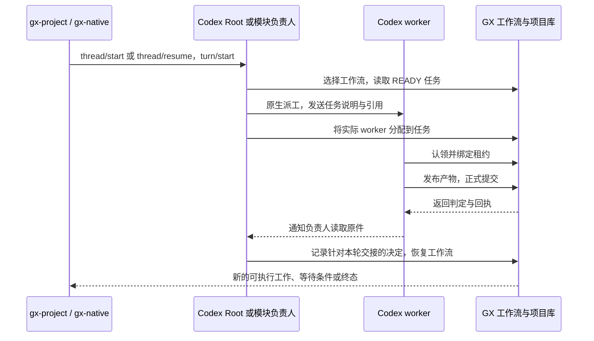

# Codex 原生协作与 GX 项目状态

一个 worker 同时参与两套协作。Codex 用线程 ID 投递消息、保留上下文。GX 用任务 ID、租约和产物引用记录本次委托。原线程可以先后承担多个任务，下一位接手者则可以从新的对话读取同一份原件。



## 从任务书到工作流

`gx-project` 保存任务书和项目设置，并在需要模型处理时启动 `gx-native`。后者通过本机 Codex App Server 的标准输入输出连接创建或恢复 Root，向新线程登记它能调用的 GX 工具。反方向上，线程调用 `gx_*` 工具会产生 `item/tool/call`。GX 按实际调用线程执行本地工具，把结构化结果返回此请求。[项目驱动](../gx_core/project_continuation.py) · [宿主桥接](../gx_core/hostobs/native_app_server.py)

在 `module_collaboration@1` 中，负责人决定把问题拆成哪些工作项。工作流读取受理的模块计划，将工作项转成 GX 任务，等待各自交付后再开放综合任务。Root 可以接受某轮交接，指定模块补做，或说明停止原因。每个决定指向实际交接件。[工作流定义](../workflows/module_collaboration/v1.json) · [执行节点](../workflows/module_collaboration/nodes.py)

## 三段关键源码

收到 Codex 的 `item/tool/call` 后，桥接层把工具名、参数、已识别的线程调用者和当前项目的数据库连接交给本地 GX 函数。代码位于 `NativeRouter.on_server_request`。[原生宿主桥接](../gx_core/hostobs/native_app_server.py)

```python
response = api.dispatch(call.tool_name, params["arguments"], principal=call.principal,
    conn=self.conn, transport=native.TRANSPORT, native_call=call)
```

模块工作项均已获得正式结果后，`_module` 把每一份原件的引用交给综合任务。它在综合也正式受理后返回这一轮的计划、结果和综合。[模块工作流](../workflows/module_collaboration/nodes.py)

```python
result_refs = [r["artifact_ref"] for r in results]
synthesis_id = _task(ctx, p.SYNTHESIS, module, module_index, role, [plan_id, *(r["task_id"] for r in results)],
    extra={**inputs, "plan_ref": plan["artifact_ref"], "lead_subject": plan["author"], "result_refs": result_refs})
synthesis = p.accepted(ctx.conn, ctx.run_id, synthesis_id, p.SYNTHESIS)
if synthesis is None:
    return [synthesis_id], None
```

`wait_for_project_work` 已记下数据库和原 Job 回执的变化信号。只剩等待时，驱动在本机睡眠，信号变化或到达复查期限才重新读取项目状态。[等待与续做](../gx_core/project_continuation.py)

```python
deadline = time.monotonic() + report["next_check_seconds"]
while (remaining := deadline - time.monotonic()) > 0 and changes(outcomes, inbox) == before:
    time.sleep(min(1.0, remaining))
```

## 什么值得持久化

普通沟通可以使用 Codex 原生消息。需要在下一次启动后继续使用的工作进入 GX 项目库。一次正式提交携带任务 ID、租约、产物引用和请求键。读者可以从提交找到当时的任务说明和原件。一个模型回合结束、一项任务受理、整个项目结案分别有自己的记录。[任务工具](../gx_core/teams/tools.py) · [产物服务](../gx_core/artifacts/service.py)

在示例中，窗口 A 的平均等候时间从 10 分钟降到 8 分钟，窗口 B 从 6 分钟升到 9 分钟。两个窗口各自的四次观测、计算和交接应当能单独取回。只看合并平均数会掩盖变化方向相反这一事实。适合独立复核的是计算及其解释，单个窗口的四次样本不能支持对总体服务质量的因果判断。[原始示例](../examples/module_collaboration/question.md)

## 断线以后

一个工作流依赖外部结果时，GX 保存检查点和未满足的条件，交回项目驱动。恢复时它读取原状态，在条件满足后推进；已成功执行的同轮节点动作可以取回先前的回执。对于执行效果仍未知的动作，需要先核对当时的记录。在等待阶段，项目驱动读取本地状态，真正有可执行事项时才交给 Root。[工作流引擎](../gx_core/orchestration/engine.py) · [项目工作判断](../gx_core/project_work.py)
